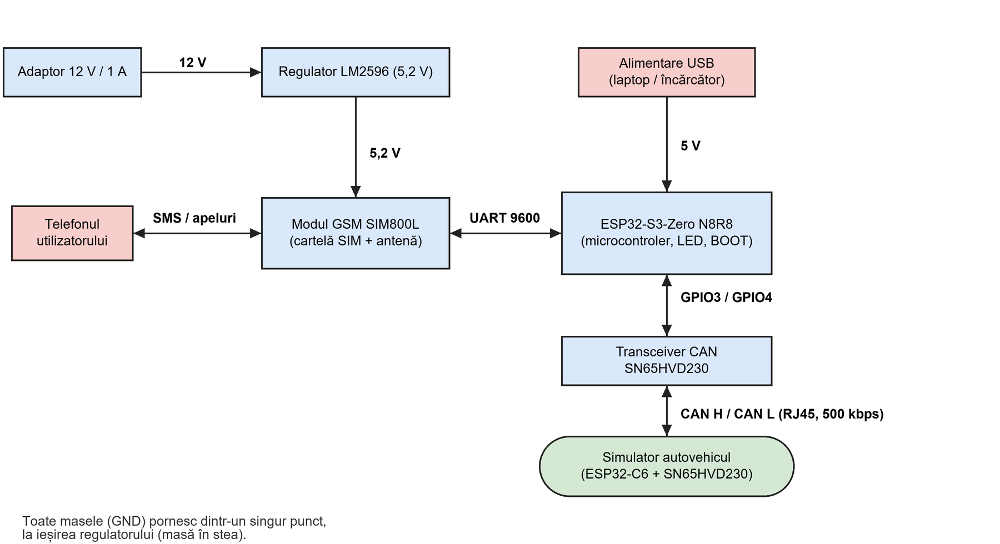

# Semnalizare în timp real a parametrilor CAN ai unui autovehicul

Modul cu **ESP32-S3** + modem GSM **SIM800L** + transceiver CAN **SN65HVD230**. Citește mesajele de caroserie și parametrii OBD-II de pe magistrala CAN și trimite proprietarului SMS-uri la evenimente. Primește comenzi tot prin SMS. Prototip de laborator, testat cu un simulator de autovehicul realizat cu **ESP32-C6**.



## Funcții
- **SMS automat** la: încuiat / descuiat, contact, motor pornit / oprit, baterie descărcată, uși, geamuri, frână de mână, defecte noi / șterse (DTC).
- **Avertismente la încuiere:** frână netrasă, autovehicul în mișcare, uși sau geamuri deschise.
- **Comenzi SMS:** `STARE`, `DIAG`, `DTC`, `STERGE DTC`, `INCUIE`, `DESCUIE`, `AJUTOR` (doar de la numărul înrolat).
- **Înrolare:** în starea din fabrică, numărul care sună de 3 ori în 3 minute devine proprietar (salvat în NVS). Apăsare lungă (5 s) pe BOOT = setări din fabrică.
- **LED RGB** de stare; apăsare scurtă pe BOOT = SMS cu starea curentă.

GPS (opțional în cerință) nu este implementat: SIM800L nu are receptor GPS.

## Structura
| Folder | Conținut |
|---|---|
| `esp32s3-monitor/` | Firmware-ul modulului (C, ESP-IDF 5.5.5): `main/main.c` |
| `esp32c6-simulator/` | Simulatorul de autovehicul (C++, PlatformIO + Arduino); modul „SIMULARE ȘASIU”: `src/chassis.cpp` |
| `docs/` | Schema electrică, schema bloc, organigrame |

## Hardware
ESP32-S3-Zero, SIM800L, SN65HVD230, LM2596 reglat la ~5,2 V (alimentează modemul), ESP32-C6-LCD-1.47 + SN65HVD230 (simulator), cartelă SIM 2G fără PIN, antenă GSM.

| Semnal | ESP32-S3 | Către |
|---|---|---|
| UART TX / RX | GPIO1 / GPIO2 | SIM800L RXD / TXD (direct) |
| CAN TX / RX | GPIO3 / GPIO4 | SN65HVD230 CTX / CRX |
| Buton, LED RGB | GPIO0, GPIO21 | pe placă |

Schema electrică: [docs/Schema_electrica.png](docs/Schema_electrica.png). Puncte critice pentru stabilitate:
- toate masele pornesc dintr-un singur punct (masă în stea);
- pinul **VDD** al SIM800L rămâne nelegat;
- modemul se alimentează de la LM2596 (5VIN), ESP32-S3 separat, prin USB;
- condensatoare de 2200 µF și 100 nF pe alimentarea modemului.

## Build și încărcare

**ESP32-S3** (ESP-IDF 5.5.x, din „ESP-IDF PowerShell”):
```
cd esp32s3-monitor
idf.py set-target esp32s3
idf.py build
idf.py -p COMx flash monitor
```

**ESP32-C6** (VS Code + extensia PlatformIO; pe Windows activați `LongPathsEnabled`):
```
cd esp32c6-simulator
pio run -t upload
```
Portul COM se detectează automat (altfel setați `upload_port` în `platformio.ini`). La pornire alegeți cu BOOT modul **SIMULARE ȘASIU**; consola serială, 115200 baud: se tastează numărul opțiunii (0–16) și Enter.

## Prima utilizare
1. Alimentați modemul și ESP32-S3; LED galben = așteaptă rețeaua, magenta = gata, număr neînrolat.
2. Sunați de 3 ori în 3 minute la numărul cartelei; se primește SMS de confirmare, LED verde.
3. Din consola simulatorului schimbați starea (ex. `0` = contact, `1` = încuiere) și urmăriți SMS-urile.

## Limitări (pe scurt)
- Codurile CAN de caroserie provin din documentații publice VW (opendbc `vw_pq.dbc`, OpenVehicles VW e-Up); geamurile și comanda de încuiere sunt **simulate**. Nu sunt verificate pe un autovehicul real, deci sistemul **nu este plug and play**.
- Uși, geamuri și încuiere circulă de regulă pe CAN-ul de confort (~100 kbps), neexpus la conectorul OBD.
- Comenzile SMS se autentifică doar după numărul expeditorului (un PIN ar fi pasul următor).
- Doar răspunsuri OBD dintr-un singur cadru (fără ISO-TP).
